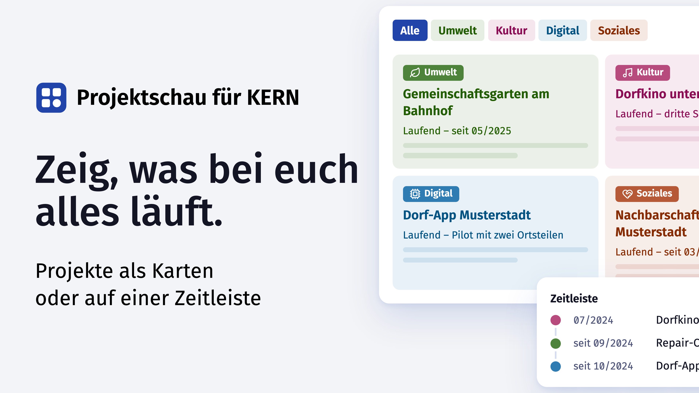

# Projektschau for KERN

A project overview with cards, filters and a timeline, built on the [KERN UX standard](https://www.kern-ux.de). A pattern for initiatives, associations and public administrations that want to show their projects on one page: each card is a project with area, category, status, description, activities, partners, key figure and links. Two languages, light and dark mode, filters by area and category, a timeline by year, deep links via the address bar.

Three files, no framework, no build step: `projektschau.js`, `projektschau.css` and a JSON data package. The KERN kit is included unchanged under `vendor/kern/`.

The pattern grew out of a [project overview](https://ankerpunkt-hoherflaeming.de/projekte/) that a regional network uses as a running project. A WordPress plugin with the same data format is being developed in parallel. The sample data in `daten/beispiel.json` is fictitious.

Source code: [github.com/donludwig/projektschau-kern](https://github.com/donludwig/projektschau-kern). This page is also available in German: `README.md`.

## 1. Demo and integration

Open `index.html` in a browser; no server is needed. The sample data is embedded in the page; the same data is in `daten/beispiel.json` for loading via `data-src`.

```html
<link rel="stylesheet" href="vendor/kern/fonts/fira-sans.css">
<link rel="stylesheet" href="vendor/kern/kern.min.css">
<link rel="stylesheet" href="vendor/kern/kern-grid.min.css">
<link rel="stylesheet" href="projektschau.css">
<script src="projektschau.js" defer></script>

<div data-projektschau data-src="daten/beispiel.json"></div>
```

Alternatively without `data-src`, with the data package inside the element:

```html
<div data-projektschau>
  <script type="application/json">{ "version": 1, "sprachen": ["de", "en"], … }</script>
</div>
```

When embedding, write `</` as `<\/` (`skripte/einbetten.py` does this); otherwise a `</script>` in a text field ends the block before the renderer runs.

The page must load the KERN kit (kit version in `vendor/kern/VERSION`). The kit is not scoped: it styles `html`, `body` and `:root`, so it belongs on pages designed with KERN throughout. The page sets the width, for example with `kern-container` (96 percent of the viewport, at most 1536 pixels). Light and dark follow the KERN mechanism: `data-kern-theme="light|dark"` on `<html>` or the system setting.

| File | Purpose |
|---|---|
| `index.html` | Demo page. Loads the kit, the supplementary CSS and the script, contains the embedded sample data and a light/dark toggle. Without inline scripts or styles, so it also runs under a strict Content Security Policy. |
| `demo-theme.js`, `demo.js`, `demo.css` | Demo page only: colour scheme before the first render, address parameters, switches, documentation link and the styling of header and footer. Not part of the pattern. |
| `projektschau.js` | Reads the data package, generates all markup and handles filters, view, language and address bar. About 340 lines, no dependencies. |
| `projektschau.css` | Additions to the kit: grid, area colours, filter bar, timeline. About 160 lines, only KERN tokens and the area colours from the data. |
| `daten/beispiel.json` | Data package of the demo, 32 fictitious projects in four areas. Template for your own data. |
| `vendor/kern/` | KERN kit [`@kern-ux/native`](https://www.npmjs.com/package/@kern-ux/native) ([source on openCode](https://gitlab.opencode.de/kern-ux/kern-ux-plain); `kern.min.css`, `kern-grid.min.css`, fonts), version in `VERSION`, update only via `skripte/kern-sync.sh`. |
| `skripte/pruefe.py` | Checks classes and tokens against the kit, the data package (keys, languages, colours, numbers, links), contrasts and the embedded data. |
| `skripte/pruefe_xss.js` | Renders the data package with Node without a browser and checks payloads in colours, keys, languages, icons, links, number and year. |
| `skripte/pruefe_fuzz.js` | Sends a thousand randomly mangled packages through the renderer: no exception, no active markup. |
| `skripte/erzeuge_last.py` | Generates a data package with many cards (default 1000) and a demo page for the load test in the browser. |
| `skripte/einbetten.py` | Writes `daten/beispiel.json` into the JSON block of `index.html`. |
| `skripte/farben.py` | Derives the values `area`, `on` and `fg` for light and dark from one base colour per area, see 2.6. |
| `skripte/doku_html.py` | Generates the pages `doku/readme.html` and `doku/readme.en.html` in KERN style from `README.md` and `README.en.md`: same header and footer as the demo, running table of contents "On this page", copy buttons on code blocks, tables in `kern-table-responsive`, DE/EN links. Requires the Python module `markdown`. |
| `skripte/kern-sync.sh` | Fetches the kit in a pinned version with checksum from the npm registry. |

### The demo page

`index.html` has a header with the links Demo and Documentation, the light/dark toggle, and a footer with the licence notes; the documentation pages carry the same header and footer. Colour scheme and language are passed along in the address when switching between pages (`?theme=dark&lang=en`), so the choice survives even when the browser allows no storage, for example Safari with files from disk. Both values are also stored in `localStorage` under `ps-theme` and `ps-lang`. The README link always points to the version in the currently active language.

### Options on the element

| Attribute | Values | Effect |
|---|---|---|
| `data-src` | path or URL | load the data package via `fetch`; an embedded JSON block takes precedence |
| `data-ansicht` | `karten` (default), `zeitleiste` | initial view (cards or timeline) |
| `data-bereich` | key of an area | preselected area filter |
| `data-ebene` | 1 to 4 | heading level of the title; card titles and years are one level below, project titles in the timeline two |
| `data-sprache` | language code | initial language. Order of resolution: choice stored in the browser, this attribute, browser language, first language of the package. The demo sets it from `?lang=` in the address. |
| `data-symbole` | `ja`, `nein` | cover with the large project icon above the card head, surface in the area colour. Without the attribute the choice stored in the browser by the icon switch applies, otherwise off. The demo sets it from `?symbole=` in the address. |
| `data-symbolschalter` | `ja` | "Icons" checkbox in the header left of the language switch, letting readers turn the cover on and off; the choice is stored in the browser (`ps-symbole`) |
| `data-zeitleiste`, `data-einordnungsfilter`, `data-sprachumschalter` | `nein` | do not render the respective part (timeline, category filter, language switch) |

## 2. Data

### 2.1 Structure of the data package

The package is a JSON object. Texts that exist in several languages are always an object with one entry per language code, for example `{"de": "Umwelt", "en": "Environment"}`. Below this is called a "language pair". Field names are German and stay as they are; they are the interface.

```
{
  "version": 1,
  "sprachen": ["de", "en"],
  "texte": { … },
  "filter_alle": { "bereich": { "label": language pair, "icon_svg": "…" } },
  "bereiche": [ … ],
  "einordnungen": [ … ],
  "projekte": [ … ]
}
```

**`sprachen`** (languages): list of language codes. The first one is the default. With a single language the language switch is omitted.

**`texte`** (texts): all interface texts that do not belong to a project.

| Path | Where it appears |
|---|---|
| `kopf.titel` | main heading above the overview |
| `kopf.einleitung` | introduction below the heading, HTML allowed |
| `filter.bereich_label`, `filter.einordnung_label` | labels of the two filter blocks; on narrow screens also the headers of the collapsible blocks |
| `filter.aria_bereich`, `filter.aria_einordnung` | `aria-label` of the two filter groups |
| `ansicht.karten`, `ansicht.zeitleiste`, `ansicht.aria` | labels of the cards/timeline switch and its `aria-label` |
| `sprache.aria` | `aria-label` of the language switch |
| `symbole.label`, `symbole.aria` | label and `aria-label` of the icon switch (option `data-symbolschalter`) |
| `leerzustand.meldung`, `leerzustand.zuruecksetzen` | message and button when no project matches the filter |
| `zeitleiste.aria` | `aria-label` of the timeline |
| `fuss.ueber.ueberschrift`, `fuss.ueber.absaetze` | optional collapsible section at the end; `absaetze` is a list of language pairs, HTML allowed. Without `fuss` there is no such section. |

**`filter_alle.bereich`:** label and icon of the "All" filter that comes first in both filter blocks.

**`bereiche`** (areas): the areas to filter by. The order of the list is the order of the filters.

| Field | Meaning |
|---|---|
| `schluessel` | technical key, lowercase letters and hyphens only, used in the address bar and in CSS variables |
| `label` | language pair, shown on filter and badge |
| `icon_svg` | icon, see 2.3 |
| `farben.hell`, `farben.dunkel` | one object each for light and dark with `area`, `on`, `fg`, see 2.4. An additional value `brand` is carried along but not used. |

**`einordnungen`** (categories): the second filter axis, for example main project, network, event, idea.

| Field | Meaning |
|---|---|
| `schluessel` | technical key as for areas |
| `label` | language pair, shown on filter and card |
| `label_zeitleiste` | language pair for the timeline; if missing, `label` is used |
| `als_filter_chip` | `true` if the category is offered as a filter; with `false` it stays visible on the card but cannot be filtered |

**`projekte`** (projects): the cards. One entry per project, the order of the list is the order in the grid.

| Field | Required | Meaning |
|---|---|---|
| `nr` | yes | running number, shown with two digits |
| `bereich` | yes | `schluessel` of an area |
| `einordnung` | yes | `schluessel` of a category |
| `icon_svg` | no | icon, see 2.3; on the card only as a cover with `data-symbole="ja"` |
| `titel` | yes | language pair, the title |
| `status` | no | language pair, a short line below the title, for example "Ongoing – since 05/2025" |
| `beschreibung` | no | language pair, description, HTML allowed |
| `abschnitte` | no | list of sections; each entry has `typ` `liste` with `label` and `punkte` (list of language pairs) or `typ` `text` with `label` and `text`. HTML allowed in `punkte` and `text`. Demo rule: the first section of a card is always a list with at least two items ([section 4.5](#45-design-rules)). |
| `kennzahl` | no | language pair, a highlighted line directly after text or list, HTML allowed; rules in 4.5 |
| `links` | no | list with `url` and `text` (language pair) |
| `zeitleiste` | no | object with `sortierung`, `zeitraum`, `notiz`, see 2.2. If missing or `null`, the project appears in the card view only. |

Empty values are written as `null` or the field is omitted; an empty list `[]` is also allowed.

### 2.2 Timeline

A project is not maintained twice. The timeline reads number, area, title and category from the project and only needs the small `zeitleiste` block:

| Field | Meaning |
|---|---|
| `sortierung` | number in the pattern `YYYYMM`, for example `202505`. The first four digits form the year under which the entry is listed; the number sets the order within the year. For equal numbers `nr` decides. |
| `zeitraum` | language pair, the text next to the line, for example "since 05/2025" or "07/2024" |
| `notiz` | language pair, optional, the short status note below the title. Appears in the timeline only, not on the card. |

### 2.3 Icons

`icon_svg` contains only the inside of an SVG icon on a 24×24 grid, without the `<svg>` wrapper, for example `<path d="M12 20v2"/><circle cx="12" cy="12" r="4"/>`. The script adds the wrapper with `viewBox="0 0 24 24"`, stroke width 2 and `currentColor`, so the icon takes the text colour of its surroundings. The demo uses icons from the [Lucide](https://lucide.dev) set (ISC licence); any set of stroke icons on a 24 grid works.

### 2.4 Area colours and contrast

Each area brings its own colours, separately for light and dark:

| Value | Use |
|---|---|
| `area` | fill of the area badge and the active area filter; basis for card tint and divider |
| `on` | text and icon on `area`, usually white |
| `fg` | text colour of the area on a light background: title, status, key figure, number, icon and inactive filter; in the timeline the dot, title and category |

Requirements checked by `skripte/pruefe.py`: `on` on `area` at least 4.5:1 in both modes; light `fg` on white at least 4.5:1. For dark mode, dark `fg` needs the same contrast against the dark KERN background; there is no automatic check for that yet, so check the value in the browser when creating it. All other colours come from the KERN tokens and are not part of the data.

### 2.5 Creating your own data

1. Copy `daten/beispiel.json` and replace the lists `bereiche`, `einordnungen` and `projekte`. Assign keys, set colours per area, add icons.
2. Adapt `texte` to your overview, at least `kopf.titel`.
3. Check: `python3 skripte/pruefe.py` reports unknown or invalid keys, missing titles, wrong formats and insufficient contrast.
4. Either load via `data-src` or embed into `index.html` with `python3 skripte/einbetten.py`. The check script reports when embedded data and JSON file diverge.

Trust boundary: Fields that allow HTML (introduction, description, sections, key figure, footer texts) are reduced to an allowlist: `a` with a checked `href`, `strong`, `em`, `p`, `br`, `ul`, `ol`, `li`; other elements and all other attributes are dropped, their text remains. All other text fields are escaped. Values that cannot be escaped are checked for their format by the renderer and left out otherwise: keys (`^[a-z][a-z0-9_-]{0,40}$`), language codes, colours (hex), link addresses (only `http`, `https`, `mailto`, `tel` and relative paths) and the number (integer); `icon_svg` is reduced to the shapes `path`, `circle`, `rect`, `line`, `polyline`, `polygon`, `ellipse` with geometry attributes. `skripte/pruefe_xss.js` verifies this without a browser using payloads.

### 2.6 Deriving colours programmatically

Only one base colour per area is maintained by hand. Everything else can be computed from it, on two levels.

**Level 1, data package:** `skripte/farben.py` generates a colour ramp from a base colour following the method of the KERN kit, and from it the `farben` block for `bereiche[]`:

```bash
python3 skripte/farben.py "#4c8438" "#b4457a"
python3 skripte/farben.py --rampe "#4c8438"
```

KERN builds its colour ramps after the ["Universal Color Palette"](https://uxdesign.cc/the-universal-color-palette-9826deb94f7) in the [Oklab](https://bottosson.github.io/posts/oklab/) colour space, described on the [KERN page on colour](https://www.kern-ux.de/2.0.6/design-system/farbe/): the steps 025 to 950 are ordered by lightness, each step has the same contrast across all hues, step 500 is the contrast middle with 4.5:1 on white and on black, and light and dark mode arise by mirroring (800 light corresponds to 200 dark). The script reproduces this:

| Step | Rule |
|---|---|
| colour space | calculation in OKLCH (lightness L, chroma C, hue H), not in sRGB or HSL. The hue of the base colour stays the same across the whole ramp. |
| lightness per step | fixed scale from 025 to 950, the mean of the eleven ramps in `@kern-ux/native` 2.8.2 (for example 300 = 75.4 %, 500 = 57.0 %, 700 = 42.4 %) |
| chroma per step | follows the profile of the [kit ramps](https://www.kern-ux.de/design-system/foundations/farbe/) (peak around 550 to 650, decreasing towards the ends); the height of the profile is chosen so that the ramp meets the chroma of the base colour at its lightness |
| gamut boundary | if a step falls outside sRGB, only the chroma is reduced; lightness and hue stay |
| step 500 | is darkened in tenths of a percent if needed until white on it safely reaches 4.5:1 |
| `area` | step 500 |
| `on` | white |
| `fg` light | step 700, as KERN sets its action colour in light mode (contrast on white about 8:1) |
| `fg` dark | step 300, the mirror of 700, as KERN's action colour in dark mode |

The base colour itself therefore does not appear unchanged but as a ramp in its hue; `area` is the 500 step of that hue. The sample data was created this way from the four base colours of the demo. The script prints the contrasts; `--rampe` shows all twenty steps as OKLCH and hex.

**Level 2, presentation:** From `area`, `on` and `fg`, `projektschau.css` derives all further shades at runtime with `color-mix`; there are no further colour values in the data:

| Shade | Formula |
|---|---|
| card surface | step 025 of the area ramp (light) or 950 (dark), computed from `area` with the relative colour syntax `oklch(from var(--ps-area) 96.4% calc(c * 0.08) h)`; browsers without that syntax get a `color-mix` approximation |
| card border, divider | step 100 (light) or 900 (dark) of the area ramp, computed the same way |
| area filter active, hover and press | `area`; hover 88 % `area` with black, press 78 % |
| area filter inactive, hover and press | border `area`, text `fg`; hover 10 % `area` over transparent, press 18 % |
| number | `fg` at 75 % opacity |
| title, status, key figure, timeline dot | `fg` unchanged |

Mixing happens in the `oklab` colour space, which keeps the shades evenly bright. In dark mode the script inserts the dark values for `area`, `on` and `fg`; the formulas stay the same and then mix with the dark KERN tokens.

### 2.7 Browsers

The renderer only needs features that have been Baseline "widely available" in all major browsers since 2023: `DOMParser`, `URL`, `color-mix()` (since May 2023), `aspect-ratio`, `:focus-visible`. Two newer features are used with a fallback: the stylesheet rules are applied through `adoptedStyleSheets` (Chrome 73, Edge 79, Firefox 101, Safari 16.4; caniuse as of 2026-10-12), older browsers get a `<style>` element that works just as well without a strict CSP. Card surfaces and borders are first declared as `color-mix()` and overridden by the relative colour syntax `oklch(from …)` where it is fully supported (Chrome and Edge 131, Firefox 133, Safari 18; 93 percent share); older browsers show the `color-mix()` version, which differs only in nuances. The KERN kit itself does not name a browser list in its package. Tested on 2026-10-12 in Chromium, Firefox 157 and WebKit 27.2 via Playwright, see [section 5](#5-checking-and-maintaining).

## 3. Processing and output

### 3.1 Flow

1. **Start:** On load, the script calls `init` for every `[data-projektschau]`. It reads the options from the attributes and takes the data from the embedded JSON block or fetches it from `data-src`.
2. **Render:** `render(data, options)` builds the complete markup as a string. There are no templates; each structure lives in a small function: `karte` for a card, `zeitleisteHtml` for the timeline, `filterBtn`, `badge`, `btn` and `icon` for the building blocks.
3. **Interaction:** `interaktion(root)` attaches the events to the rendered markup: language switch, filters, view, reset, address bar, collapsible blocks.

Both functions are also available from outside as `window.Projektschau.render` and `window.Projektschau.init`, for example to pre-render the markup on the server.

### 3.2 Where each field is shown

Card view, top to bottom:

| Place | Field | Markup |
|---|---|---|
| Column and card | – | `kern-col-12 kern-col-md-6 kern-col-lg-4 kern-col-xxl-3 ps-col` > `kern-card kern-layer kern-level-1 ps-card` with `data-bereich` and `data-cat` |
| Area badge | `bereiche[].icon_svg`, `bereiche[].label` | `kern-badge kern-badge--small ps-badge` in area colour, with the area icon, on card and timeline |
| Category badge | `einordnungen[].label` | `kern-badge kern-badge--small` neutral |
| Number | `nr` | `ps-num`, right, area colour muted |
| Icon | `icon_svg` | `kern-card__media ps-cover` above the head, visible only with the cover switched on (`data-symbole` or icon switch, [section 1](#1-demo-and-integration)) |
| Title | `titel` | `kern-title` in area colour, one step larger than in the kit |
| Status | `status` | `kern-subline kern-subline--small` in area colour |
| Description | `beschreibung` | `kern-body` |
| Sections | `abschnitte[]` | `label` as `kern-label`, `liste` as `kern-list kern-list--bullet kern-list--small`, `text` as `kern-body kern-body--small` |
| Key figure | `kennzahl` | `kern-body ps-kpi` with `<strong>`, area colour, directly after text or list |
| Divider | only if `links` present | `kern-divider kern-divider--decorative ps-card-divider` |
| Links | `links[]` | `kern-link kern-link--small` in `kern-card__footer`, 16 pixels like the rest of the card text |

Timeline, one group per year:

| Place | Field | Markup |
|---|---|---|
| Year heading | from `zeitleiste.sortierung` | `kern-heading kern-heading-medium ps-tl-jahr` |
| Period | `zeitleiste.zeitraum` | `ps-tl-zeit`, left column, on mobile above the entry |
| Dot on the line | colour from `bereiche[].farben.*.fg` | pseudo-element of `ps-tl-main` (mobile: of `ps-row`) |
| Number, badge, title, category | `nr`, `bereiche[].label`, `titel`, `einordnungen[].label_zeitleiste` | one line `ps-tl-kopf`, all on a shared baseline |
| Note | `zeitleiste.notiz` | `kern-body kern-body--small ps-tl-notiz` |

Filter bar: area filters from `bereiche` with icon and hit count, the cards/timeline switch to the right, below that the category filters from the categories with `als_filter_chip: true`. The hit counts take both axes into account: the counter of an area counts only projects that also match the selected category, and vice versa.

### 3.3 Languages

Each language pair is rendered as a sequence of elements with a `lang` attribute, one per language, for example `<span lang="de">Umwelt</span><span lang="en">Environment</span>`. Block texts with HTML use `div` elements. If all variants are identical or there is only one language, the text is output without a wrapper.

The script generates one CSS rule per language and puts it into a `<style>` before the wrapper: `.ps[data-lang="de"] [lang]:not([lang="de"]) { display: none }`. Switching the language only changes `data-lang` and `lang` on the wrapper; all texts stay in the document, and search engines and screen readers see the active language correctly marked up. `aria-label` texts are stored as `data-aria-<language>` on the element and rewritten on switch. The chosen language is remembered under `ps-lang` in `localStorage`.

### 3.4 Area colours in the markup

When rendering, the script writes the light colours of all areas as CSS variables into a generated `<style>` before the wrapper, rule `.ps { … }`: `--ps-area-umwelt`, `--ps-area-umwelt-on`, `--ps-area-umwelt-fg` and so on per key. A `style` attribute would be unsuitable because it would override the dark rules. The dark colours are in the same `<style>` under the KERN theme selectors `[data-kern-theme="dark"] .ps`, `.kern-dark .ps` and, as a fallback for the system setting, `@media (prefers-color-scheme: dark)`.

Every element that belongs to an area (card, timeline row, area filter, badge) gets three generic variables via its `style` attribute: `--ps-area`, `--ps-area-on`, `--ps-area-fg`, pointing to the variables of its area. The CSS only works with these three names and does not know the areas. New areas therefore need no CSS change.

### 3.5 Filters, view and address bar

Every card and every timeline row carries `data-bereich` and `data-cat`. A filter click updates `aria-pressed` and the button variants, checks each element against both active filters and sets the class `is-hidden`. Years without a visible row are hidden, the first visible row of a year gets the class `ps-row--erste` (there the line starts at the dot), and with zero hits the empty state with a reset button appears. The live region `ps-live` announces the hit count to screen readers; its texts are in the script (`LIVE`, `LEER`) and can be replaced via the options `live` and `leer` when calling `render` directly.

The state is kept in the address bar after `#`, for example `#bereich=kultur&filter=netzwerk&ansicht=zeitleiste`, and restored on load and on `hashchange`. Any selection can thus be shared as a link.

Area and category filters each live in a KERN details component. From 48rem viewport width the script sets both to `open` and the class `ps-panel--offen`; the CSS then hides the headers and shows the labels inline. Below that width the headers "Area" and "Filter" act as toggles; the area block starts open, the category block closed.

## 4. Styling

### 4.1 The KERN kit

The kit is included unchanged under `vendor/kern/` (`kern.min.css`, [Fira Sans](https://github.com/mozilla/Fira) in the weights 400, 400 italic, 500, 600 and 700, licence, version file). The demo page sets `data-kern-theme` from `localStorage` (key `ps-theme`) before the first render so nothing flashes. The grid fills the width with as many columns as cards of at least 18rem fit.

### 4.2 KERN components used

| Component | Use |
|---|---|
| `kern-card` with `__container`, `__header`, `__body`, `__footer` | the card in its compact variant `kern-card--small` (8 pixels between header, body and footer, 16 pixel texts), padding 24 pixels (`--kern-metric-space-large`) via an own rule |
| `kern-hgroup`, `kern-title`, `kern-subline` | title block of the card with status |
| `kern-badge kern-badge--small` | area and category on card and timeline |
| `kern-btn` with `--x-small`, `--primary`, `--secondary`, `--tertiary`, `kern-btn-wrapper` | filters, view and language switches (x-small), reset (tertiary); active is `--primary`, inactive `--secondary`, state also in `aria-pressed` |
| `kern-form-check` with `__checkbox` and `kern-label` | icon switch as a checkbox (the kit has no toggle switch) |
| `kern-details` with `__header`, `__body` | area and category filters, optional "About" section |
| `kern-row`, `kern-col-12`, `kern-col-md-6`, `kern-col-lg-4`, `kern-col-xxl-3` (from `kern-grid.min.css`) | card grid: one, two, three and from 1600 pixels four columns at the KERN breakpoints |
| `kern-stack-lg`, `kern-stack-sm` | vertical spacing in the wrapper and the head |
| `kern-layer kern-level-1` | the card as a raised surface with the contextual tokens of the kit |
| `kern-divider kern-divider--decorative` | divider before the links |
| `kern-heading-x-large`, `kern-heading-medium`, `kern-body`, `kern-label`, `kern-list`, `kern-link`, `kern-sr-only` | typography, lists, links, screen reader text |

KERN has no chip or tag toggle, no segmented control and no tabs. Filters and switches are therefore buttons with `aria-pressed`. For the cards/timeline switch, a "Segmented Control" component has been proposed in the KERN project ([issue 1141 in the KERN main repository](https://gitlab.opencode.de/kern-ux/pattern-library/-/work_items/1141), in refinement as of October 2026, semantics as `radiogroup` or as a button group with `aria-pressed` still open). Until then the switch here is custom-built from joined KERN buttons and will be aligned with the component once it is part of the kit.

### 4.3 Own additions

All own classes carry the prefix `ps-`, all values come from KERN tokens or the three area variables. Two set values remain because the kit has no tokens for them: `--ps-tl-mitte` (17 pixels) is the height of the first line in the timeline to which dot and period are aligned, on mobile half the line height from the token; and 200 milliseconds for the transition of the cover icon. Everything else, including dot size, line width and period column, comes from tokens.

| Class | Purpose |
|---|---|
| `.ps` | wrapper; spacing comes from `kern-stack-lg` |
| `.ps-head`, `.ps-lede`, `.ps-kopfzeile`, `.ps-symbolschalter`, `.ps-lang` | head area, introduction, top-right row with icon switch and language switch |
| `.ps-controls`, `.ps-controls-divider` | filter bar as a grid: area block left, switch right, category block below, `kern-divider` at the end; sticks to the top, slightly transparent with blur |
| `.ps-filter`, `.ps-filter-label`, `.ps-view`, `.ps-count` | filter rows as a grid (label left, buttons wrap within their column), view switch (up to 64rem as a full row on top), hit count |
| `.ps-btn-bereich` | area filter in area colour, active filled, inactive with coloured border, hover and active as a blend of the area colour |
| `.ps-seg` | two buttons joined into one switch; colours and radius remain those of the buttons |
| `.ps-panel`, `.ps-panel-bereich`, `.ps-panel-cat`, `.ps-panel--offen` | the two filter blocks as details: open without header on desktop, collapsible on mobile with a header in label size |
| `.ps-grid`, `.ps-col` | row and columns of the KERN grid with a 24 instead of 32 pixel gutter (12 pixels per column side from the `large` token); `.ps-col` stretches the card to row height |
| `.ps-card` | surface and very subtle border as steps 025 and 100 of the area ramp, in dark mode 950 and 900 |
| `.ps-cover`, `.ps-cover-icon` | optional 16:9 cover above the card head, surface step 100 of the area ramp (dark 900), icon 22 percent of the card width in `fg`, grows smoothly to 115 percent on pointer or focus on the card (200 milliseconds, none with reduced motion); visible only with the cover switched on |
| `.ps-tags`, `.ps-badge`, `.ps-num` | head line of the card, badge in area colour with more padding, number on the right |
| rules on `.kern-title`, `.kern-subline`, `.ps-kpi` in `.ps-card` | area colour and title size; their specificity is above the card rules of the kit because those would win otherwise |
| `.ps-field`, rules on `.kern-list--bullet` in the card | field label without bottom spacing, lists with 4 instead of 24 pixel spacing and 20 instead of 32 pixel indent |
| `.ps-card-divider` | divider in the border blend |
| `.ps-tl`, `.ps-year`, `.ps-tl-jahr`, `.ps-tl-liste`, `.ps-row`, `.ps-tl-zeit`, `.ps-tl-main`, `.ps-tl-kopf`, `.ps-tl-titel`, `.ps-tl-cat`, `.ps-tl-notiz` | timeline: grid with a 96 pixel period column (3 × `x-large`), 2 pixel line with 16 pixel dot, the line starts at the dot for the first visible row of each year, head line on a baseline; below 40rem the period sits above the entry, the line runs along the row edge, the dot sits at the period |
| `.ps-empty` | empty state: text and tertiary button in `kern-stack-sm`, with `role="status"` |
| `.ps-live` | live region, visually hidden via `kern-sr-only` |

The gradation of the area colour on the card, from strong to quiet: badge and active filter (`area` full), title, status, key figure, dot (`fg` full), number (`fg` at 75 percent opacity), border and divider (step 100), surface (step 025).

### 4.4 Where to adjust what

| Wish | Place |
|---|---|
| colours of an area | only in the data: `bereiche[].farben` |
| interface texts | only in the data: `texte` |
| which categories are filterable | `einordnungen[].als_filter_chip` |
| order of filters and cards | order of the lists `bereiche` and `projekte` |
| initial view, preset filter, heading level, hiding parts | attributes on the element, [section 1](#1-demo-and-integration) |
| strength of the card tint or border | percentages in `.ps-card` and `.ps-card-divider` |
| size of card title or timeline title | token assignment in the rules on `.kern-title` in `.ps-card` or `.ps-tl-titel`; suitable steps are `medium-static` (18), `large-static` (21), `medium-adaptive` (21/24) |
| card padding | token in the rule on `.ps-card .kern-card__container`; without it the compact variant's 16 pixels apply |
| grid gutter | token in the rules on `.ps-grid.kern-row` and `.ps-grid.kern-row > .ps-col`; without these rules the kit's 2rem apply |
| number of grid columns | `kern-col-*` classes in `karte()` in the script (default 12, md 6, lg 4, xxl 3) |
| sticky filter bar | remove `position: sticky` in `.ps-controls` |
| content shows through above the filter bar in Safari on iPhone | from iOS 26, Safari draws the page under the status bar too and covers that area only when the sticky surface spans at least 90 percent of the window width, has a plain background colour and no blur. The demo solves this at the end of `demo.css` with a rule on `.ps-controls`; on your own page, adjust the margins of that rule to the layout |
| width of the period column | token calculation in `.ps-row` (3 × `x-large`, 96 pixels) |
| breakpoints | `48rem` in the script (collapsible blocks), `64rem` in the CSS (view switch), `40rem` in the CSS (timeline) |
| texts of the live region | constants `LIVE` and `LEER` in the script or options `live`/`leer` on `render` |
| focus colour, action colour, font | not in the pattern but via the KERN theme tokens of the page, for example `--kern-color-action-focus-default` on `:root` |

Not intended: custom fonts (KERN specifies Fira Sans), a separate colour system next to the tokens, and scoping the kit for pages not designed with KERN.

### 4.5 Design rules

These rules describe how the demo is designed. Anyone adapting the pattern keeps to them or changes them here as well. All values are KERN tokens; the pixel figures give the token's value.

**Principles**

- Only classes that exist in the kit. Own classes carry the prefix `ps-` and only add what KERN lacks. No fixed colour or pixel value except `--ps-tl-mitte`.
- Three text sizes in the pattern: 16 pixels (`small-static`) for all running text, including badges, number, status, lists, links and period; 21 pixels, 24 from desktop up (`medium-adaptive`) for the card title; 21 pixels (`large-static`) for the title in the timeline. Plus `kern-heading-x-large` for the page title and `kern-heading-medium` for the year. Line height 24 pixels (`medium-static`), 28 or 32 for the card title.
- Spacing in four steps: 4 (`x-small`), 8 (`small`), 16 (`default`), 24 pixels (`large`). Things that belong together sit 4 or 8 apart, blocks are separated by 16 or 24.
- Area colour only via the three variables `--ps-area`, `--ps-area-on`, `--ps-area-fg`, graded from strong to quiet (end of 4.3). Everything else from kit tokens: action colour for switches, classification filters and links, `decorative-border` for lines, `text-muted` for the period.
- States: active is `kern-btn--primary`, inactive `kern-btn--secondary`, plus `aria-pressed`. Focus, hover and active come from the kit; for area buttons they are mixed from the area colour, as the kit does with the action colour.
- Dark mode mirrors the ramp: surface 950 instead of 025, border and divider 900 instead of 100, `fg` 300 instead of 700. No separate dark colours.
- Icons: Lucide, 1em in buttons and badges (area icon on card and timeline), always in the colour of the adjacent text. No icon next to the card title; the project icon appears only as an optional cover.

**Content**

The rules for texts so that all cards share one structure.

- Title without a full stop; status as a short line following the pattern "Running – since 05/2025", "Planned for 06/2026" or "Idea – not yet started".
- Description one or two sentences; key figure and list items one line each.
- The first section below the description is a list with at least two items; each item starts with a capital letter and ends without a full stop. Cards without a section stay short.
- The key figure starts with a capital letter ("Around 90 assignments per month", not "around …"), ends without a full stop and separates thousands with a comma in English ("2,300 pictures") and a dot in German. It directly follows text or list.
- Links only in the card footer; the link text names the target ("About the garden", "Programme"), never "here" or "more".
- Timeline: period as "since 05/2025" or "07/2024", note a short sentence without a full stop.
- Both languages equally long and equally structured; numbers and dates identical in both.

**Page header**

| Element | Rule |
|---|---|
| Title | level from `data-ebene` (default `h1`), `kern-heading-x-large` |
| Intro | `kern-body kern-body--large`, paragraphs 8 pixels apart, note in bold within the text |
| Language switch | top right, two `kern-btn--x-small` (32 pixels, like cards/timeline) as a joined switch (`ps-seg`), active `primary`; `role="group"` with label from the data |
| Icon switch | left of the language switch with an 8 pixel gap, a KERN checkbox (`kern-form-check`, 32 pixels) with the label from `texte.symbole.label` and `aria-label` from `texte.symbole.aria`; border and label in the kit's action colour, checked state as in the kit; only with `data-symbolschalter="ja"` |
| Spacing | `kern-stack-sm` (8 pixels) inside the header, `kern-stack-lg` (32 pixels) between header, filter bar and grid |

**Filter bar**

| Element | Rule |
|---|---|
| Bar | sticks to the top edge, background 88 percent of the page colour with 8 pixel blur, 16 pixel padding on top, closed by `kern-divider--decorative` |
| Layout | grid: area block left, cards/timeline switch right on the same row, classification block below; 16 pixels between blocks |
| Label | `kern-label` in an 80 pixel column (2.5 × `x-large`), shifted down 4 pixels so it is centred on the first button row |
| Buttons | `kern-btn--x-small`, 32 pixels high, 8 pixels apart in both directions (the kit's 8 pixel top and bottom margins are removed), wrapping within their column |
| Area buttons | active: surface `area`, text `on`; inactive: border `area`, text `fg`; hover and active as mixes of `area` (88 and 78 percent with black, or 10 and 18 percent over transparent); area icon in front |
| Classification buttons | the kit's action colour, otherwise like area buttons |
| Count | in brackets after the label, 80 percent opacity, follows the label's state |
| Cards/timeline switch | two `kern-btn--x-small` as `ps-seg`, level with the first button row; up to 64rem a full row above the filters with two equal halves |
| Mobile (below 48rem) | both blocks as `kern-details`, header in label size and action colour with a 20 pixel arrow, label on its own line, content not indented |

**Card grid**

| Element | Rule |
|---|---|
| Columns | KERN grid: 1, from `md` 2, from `lg` 3, from `xxl` 4 columns |
| Gutter | 24 pixels (`large`) instead of the kit's 32, 12 per column side |
| Height | all cards in a row equally high; the body stretches, divider and links always sit at the bottom edge |

**Card**

| Element | Rule |
|---|---|
| Component | `kern-card kern-card--small` as `kern-layer kern-level-1`; compact variant for the 8 pixel gap between header, body and footer and the 16 pixel texts, but 24 pixel padding (`large`) |
| Surface, border | steps 025 and 100 of the area ramp (light), 950 and 900 (dark), 1 pixel border, kit radius |
| Order | optional cover, head line, title, status, text, fields with lists, key figure, divider, links |
| Cover (option) | `kern-card__media` at 16:9, surface step 100 of the area ramp, project icon 22 percent of the card width in `fg`, top corners in the card radius; on pointer or focus on the card the icon grows smoothly to 115 percent, without transition under reduced motion; only with the cover switched on, otherwise the head line is the first element |
| Head line | area badge with icon, classification badge without surface, number on the right; 4 pixels between badges, 8 pixels below |
| Badge | `kern-badge--small`, padding 2 and 8 pixels, surface `area`, text `on`, 16 pixels semibold; icon 1em with 4 pixel gap |
| Number | two digits with leading zero, 16 pixels regular, `fg` at 75 percent opacity, tabular figures, without baseline padding so it lines up with the badge |
| Title | `kern-title`, 21/24 pixels, colour `fg`, without icon |
| Status | `kern-subline--small` directly under the title without the kit's top baseline padding, 16 pixels, colour `fg` |
| Text | `kern-body`, 16 pixels, the kit's text colour |
| Field | label `kern-label` semibold, 4 pixels to its content; below it always a list `kern-list--bullet kern-list--small` with at least two items and 4 pixels between them, indented 20 pixels (`default` + `x-small`, the kit uses 32). No running text as the first section so the cards share one structure; cards without a section stay short |
| Key figure | `kern-body` bold, colour `fg`, directly after text or list, never pushed to the bottom edge (that is reserved for the links); always starts with a capital letter ("Around 90 assignments per month"), no full stop; thousands separated by a comma in English ("2,300 pictures") and by a dot in German |
| Divider | `kern-divider--decorative` in step 100, 16 pixels above and 0 below; with the card's 8 pixel gap that is 24 to the key figure and 8 to the links |
| Links | `kern-link kern-link--small`, 16 pixels, action colour, underlined, 16 pixels apart, wrapping |

**Timeline**

| Element | Rule |
|---|---|
| Year | `kern-heading-medium`, 8 pixels below, 24 pixels between years; years without visible entries are hidden |
| Row | grid with a 96 pixel period column (3 × `x-large`) and 16 pixels to the line; 24 pixels below each entry, 4 below the last |
| Period | `kern-body--small kern-body--muted`, right-aligned, level with the first line |
| Line, dot | line 2 pixels (`border-width-default`) in `decorative-border`, dot 16 pixels (`dimension-x-small`) in `area`, centred on the line; the line starts at the first and ends at the last visible dot of the year |
| Head line | on the baseline: number, area badge with area icon (raised 2 pixels so it is centred on the title line), title `kern-title` 21 pixels in `fg`, classification `kern-label--subtle` in `fg`; 8 pixels apart, 4 when wrapping |
| Note | `kern-body--small`, 4 pixels below the head line, the kit's text colour |
| Mobile (below 40rem) | period above the entry, 8 pixels below it; line at the left edge of the whole row, dot level with the period; list indented 8 pixels so the dot disappears behind the filter bar when scrolling |

**Empty state and messages**

| Element | Rule |
|---|---|
| Empty state | `kern-body` and `kern-btn--tertiary` in `kern-stack-sm`, no box, `role="status"`; button not stretched |
| Live region | `kern-sr-only`, `aria-live="polite"`, announces the count after every filter change |

## 5. Checking and maintaining

- `python3 skripte/pruefe.py` must report "ALLE PRÜFUNGEN BESTANDEN" (all checks passed). It verifies that every `kern-*` class and every `--kern-*` token used exists in the kit, that the data package is consistent (known keys, title in every language), that badge and title contrasts suffice, and that the embedded data matches the JSON file.
- After every change to `daten/beispiel.json`: `python3 skripte/einbetten.py`.
- After every change to `README.md` or `README.en.md`: `python3 skripte/doku_html.py` (requires the Python module [`markdown`](https://python-markdown.github.io)).
- `node skripte/pruefe_fuzz.js 1000 42` must report "ALLE PRÜFUNGEN BESTANDEN" (count and seed are free to choose).
- Print view: print the demo in the browser or check it via Playwright `emulateMedia({ media: 'print' })`; only title, introduction and cards may appear.
- Load test: `python3 skripte/erzeuge_last.py 1000` writes `last-test.html` with 1000 cards (not in the repository); open it in the browser and check filters, timeline and language. Measured: 205 ms to first render, 5 ms per filter click. Browser matrix and accessibility (axe-core via Playwright) are not part of this package and run by hand before a release, the Content Security Policy with a server that sets `style-src 'self'`.
- `node skripte/pruefe_xss.js` must also report "ALLE PRÜFUNGEN BESTANDEN": it renders the sample data with payloads in area colour, key, language code, icon, number, link and year and searches the output for active markup. Run it after every change to the renderer.
- Reporting vulnerabilities: [`SECURITY.md`](SECURITY.md) states the address, the time frames and what belongs to the pattern.
- Bill of materials: `SPDX_projektschau-kern.spdx.json` (SPDX 2.3) lists the pattern, the KERN kit, Fira Sans and the icons of the sample data with version, licence, copyright and checksum; the licence texts sit next to it as `LICENSE`, `vendor/kern/LICENSE.md`, `LICENSE-fira-sans.txt` and `LICENSE-lucide.txt`; it is generated when the package is built, do not edit by hand.
- Release: the zip comes with a file holding its SHA-256 checksum (`shasum -a 256 -c <zip>.sha256`).
- Updating the kit: enter version and checksum in `skripte/kern-sync.sh`, run the script, then `pruefe.py`, because new kit versions may rename classes.
- Check in the browser: card count, filters with counters, language switch, timeline, light and dark, keyboard operation with visible focus, widths 400, 820 and 1280 pixels.

## 6. Accessibility

Self-assessment, not a formal audit; goal, checks and open points are listed in [`ACCESSIBILITY.md`](ACCESSIBILITY.md). All controls are buttons or links with the focus ring of the kit, reachable in display order. Filters and switches carry `aria-pressed`, groups carry `aria-label` in the active language. Results are announced via a live region. Icons are decorative (`aria-hidden`); every piece of information is also available as text. Contrasts for text and surfaces come from KERN; for the area colours the requirements in 2.4 apply. Without JavaScript the element stays empty because the cards are rendered from the data package; to avoid that, generate the markup on the server beforehand with `Projektschau.render`.

## 7. Security

This pattern was built with [Claude Code](https://claude.com/claude-code) ([section 9](#9-origin-and-further-development)). That is why this chapter lists what I checked, with which tools, and what is still open. I ran all checks myself, with automated tools and AI-assisted reviews. There has been no review by independent third parties. As of 13 October 2026, release 0.1.0.

The pattern runs entirely in the browser. It has no server part and no login, it collects no data from visitors and makes no external requests; kit, fonts and data are local. The only thing that comes from outside is the data package: the JSON file with areas, projects and texts that the operator provides ([section 2](#2-data); in the demo `daten/beispiel.json`). The renderer builds the cards from it. It checks every field of it before it reaches the page, even when the file comes from the operator, because it may originate from an editorial system with several roles. [Section 2.5](#25-creating-your-own-data) describes how each field is handled. The checks below focus on this path.

Everything the package brings along from others (KERN kit, Fira Sans, symbols from Lucide) is listed in the bill of materials with origin and licence, the kit also with a checksum. The components with a version number were looked up in the [OSV](https://osv.dev) vulnerability database, with no hits ([section 7.1](#71-what-was-checked)).

### 7.1 What was checked

| Check | Approach | Result |
|---|---|---|
| Review for DOM XSS | AI-assisted code review of renderer, demo and scripts; sources: data package, address, hash, browser storage, embedded JSON | 7 findings, fixed |
| Payloads in the renderer | `skripte/pruefe_xss.js` renders the sample data with payloads in colour, key, language code, symbol, number, link and year and looks for active markup | passed |
| Fuzzing | `skripte/pruefe_fuzz.js`: 1000 and 2000 randomly mangled packages with a fixed seed (fields removed, wrongly typed, nested) | no exception, no active markup |
| Unicode control characters | Bidi, zero-width and control characters in texts and link texts | are removed |
| Misuse (sharp edges) | Trail of Bits method: options, data fields, embedding and silent failure paths from the view of operations and editors | 3 findings, fixed |
| Insecure defaults | Trail of Bits method: from credentials to errors that fail open instead of closed | no finding |
| Security review of the whole code | Data flow from source to output | no finding of medium severity or above; one note implemented |
| Content security policy | Demo under `default-src 'self'` without `unsafe-inline` | works; the renderer sets its rules through `adoptedStyleSheets`, the demo runs without inline scripts and inline styles |
| Secrets in the history | gitleaks across all commits | nothing found |
| Linters and data check | ESLint and stylelint; `skripte/pruefe.py` checks every KERN class and token against the kit, the data package and the contrasts in light and dark | no finding |
| Markup | html-validate on demo, documentation and rendered DOM | no finding |
| Accessibility | axe-core for WCAG 2.1 AA and 2.2 AA with best practices: cards, timeline, light and dark, both languages, widths 1280, 390 and 320 pixels; contrast of every text recalculated, also on hover; keyboard pass with a check of the focus ring; text spacing, 200 % font size, reduced motion | no open violations |
| Browsers and load | Chromium, Firefox and WebKit without console errors; 1000 cards | passed; 205 ms to render, 5 ms per filter click |
| Lighthouse 13.5 | Demo page of the package, mobile profile with simulated throttling, compressed delivery | accessibility 100, best practices 100, performance 81. The pattern itself adds about 29 KB compressed (CSS, JavaScript, sample data); a KERN page loads kit and font anyway |
| Supply chain | KERN kit in a fixed version, SHA-512 checksum before unpacking; SHA-256 checksum for the zip | kit, Fira Sans and Lucide recorded, licence texts in the package |
| Bill of materials | validated against the SPDX 2.3 JSON schema; compared with the package content on every build; KERN kit 2.8.2 and Lucide 1.49.0 looked up in the OSV vulnerability database (13 October 2026) | valid and up to date; no known vulnerabilities |

### 7.2 Tools

| Tool | Used for | In the package |
|---|---|---|
| `skripte/pruefe.py`, `skripte/pruefe_xss.js`, `skripte/pruefe_fuzz.js` | Data package, classes, tokens and contrasts; payloads; fuzzing | yes |
| [Claude Code](https://claude.com/claude-code) with [`/security-review`](https://github.com/anthropics/claude-code-security-review) | Code reviews for DOM XSS and security review of the whole code | no |
| [Trail of Bits Skills](https://github.com/trailofbits/skills): [sharp-edges](https://github.com/trailofbits/skills/tree/main/plugins/sharp-edges), [insecure-defaults](https://github.com/trailofbits/skills/tree/main/plugins/insecure-defaults) | Reviews for misuse and insecure defaults | no |
| [axe-core](https://github.com/dequelabs/axe-core) 4.14 | Accessibility | no |
| [Playwright](https://github.com/microsoft/playwright) 1.64 | Browser matrix, keyboard, contrasts, content security policy, print view | no |
| [Lighthouse](https://github.com/GoogleChrome/lighthouse) 13.5 | Accessibility, best practices, performance | no |
| [html-validate](https://gitlab.com/html-validate/html-validate) 11.16 | Markup | no |
| [ESLint](https://github.com/eslint/eslint) 10.12, [stylelint](https://github.com/stylelint/stylelint) 17.16 | JavaScript and CSS | no |
| [gitleaks](https://github.com/gitleaks/gitleaks) 8.30 | Secrets in the history | no |
| [SPDX 2.3](https://spdx.github.io/spdx-spec/v2.3/) with [JSON schema](https://github.com/spdx/spdx-spec/blob/support/2.3/schemas/spdx-schema.json) | Format and validation of the bill of materials `SPDX_projektschau-kern.spdx.json` | bill of materials yes, schema no |
| [OSV](https://osv.dev) ([repository](https://github.com/google/osv.dev)) | known vulnerabilities of the components | no |

The tools outside the package run locally before every release. The three check scripts in the package only need Python and Node.js and run after every change to the renderer ([section 5](#5-checking-and-maintaining)).

### 7.3 What is still open

- Independent review: there has been no penetration test and no audit by third parties.
- Screen reader and usability test: axe-core covers only part of the criteria. A pass with a screen reader and a test with users are still to come.
- KERN kit: the [kit](https://gitlab.opencode.de/kern-ux/kern-ux-plain) is included unchanged in a fixed version. What is checked: the package matches the registry and every class used exists in it. I have not reviewed the kit itself.
- [Trusted Types](https://developer.mozilla.org/en-US/docs/Web/API/Trusted_Types_API): not tested. The renderer sets the checked markup through `innerHTML` in one place; a page that enforces Trusted Types needs its own policy for that.
- Automated pipeline: the checks do not yet run by themselves on every change, I run them locally by hand.
- Signature: the zip comes with a SHA-256 checksum, not yet with a signature.
- Vulnerabilities of the components: the [OSV lookup](https://osv.dev) is a snapshot. There is no regular lookup yet; for Fira Sans the bill of materials gives no version that could be looked up.
- Embedding page: server, headers and content security policy belong to the operator. Anyone who calls `Projektschau.render` themselves and processes the result further leaves the checked path.

Please report vulnerabilities privately: [`SECURITY.md`](SECURITY.md) gives address and deadlines.

## 8. Licence

Code and documentation: [EUPL-1.2](LICENSE) ([licence text at the EU](https://eupl.eu/1.2/en/)). KERN kit: EUPL-1.2 (`vendor/kern/LICENSE.md`). [Fira Sans](https://github.com/mozilla/Fira): [SIL Open Font License 1.1](https://openfontlicense.org). Icons in the sample data after [Lucide](https://lucide.dev) ([ISC](https://github.com/lucide-icons/lucide/blob/main/LICENSE)).

## 9. Origin and further development

### 9.1 How this project came about

The starting point is a [project overview](https://ankerpunkt-hoherflaeming.de/projekte/) that a regional network uses as a running project; a WordPress plugin is being developed from it in parallel. From there come the data package format, the logic for filters, timeline, languages and address bar, and the design decisions that were transferred to KERN here. The KERN pattern was created with Claude Code, Anthropic's command line tool. The roles: the user sets direction, standards and decisions and checks every state in the browser; the AI reads the sources ([KERN kit](https://www.npmjs.com/package/@kern-ux/native), [KERN documentation](https://www.kern-ux.de), [catalogue terms](https://katalog.kern-ux.de/de/nutzungsbedingungen), the existing project overview), writes code and documentation, measures in the browser and explains what is kit and what is custom.

The process in stages:

1. **Plan:** First, plan mode was used to clarify what is realistic. Result: a self-contained project, EUPL-1.2 because of the catalogue terms, a standalone demo, target KERN catalogue.
2. **Scaffold:** fetch the KERN kit in a pinned version, write renderer and CSS, demo with fictitious sample data, check script.
3. **Aligning with the original:** step by step the presentation was brought closer to the existing project overview, always asking what of it is KERN standard. Kit components before custom code; custom code only from KERN tokens and named in the README.
4. **Fine-tuning by screenshot:** Most instructions were a screenshot plus one sentence, such as "icon centred on the first line of the heading", "area and filter on the height of the first row", "the line must not stick out above the dot". Every change was measured in the browser, documented and committed individually.
5. **Documentation:** one README with sections instead of several documents, bilingual, generated as pages in KERN style.

What proved useful: every answer from the AI names what is kit and what is a deviation. The check script runs before every commit. Decisions are small and individual, not one big rebuild. And the question "is this KERN standard?" stood above every proposal.

### 9.2 Thank you

Thanks to [Axel Wolters](https://gitlab.opencode.de/OC000011858689), Senate Chancellery of Hamburg and representative of the client Hamburg in the KERN project, for looking at the KERN pattern, and to the whole [KERN](https://www.kern-ux.de) team for the continuous, great exchange and the supportive atmosphere. Come and join: [community and contributing at KERN](https://www.kern-ux.de/community-und-mitwirken/) (in German). Thanks to [Michael Plas](https://michaelplas.de) for looking at the WordPress version. What comes of the feedback goes into the changelog.

### 9.3 The prompts to copy

The most important instructions in the order they were given, linguistically smoothed and translated from German. They can be reused for a similar project; adjust paths and addresses.

```
Build a KERN version within this project, using the knowledge from the WordPress plugin. Take along the knowledge from the KERN UX theme for WordPress on openCode and the latest KERN version if necessary. Preferably clarify in plan mode first what is realistic, possibly a standalone version for KERN only, since the plugin for WordPress already exists.
```

```
Add as a goal that it should go into the KERN catalogue. Read the documentation and all requirements for that. The WordPress plugin is independent of it, so this is a subproject.
```

```
Fill the standalone demo page with sample content, about 32 cards and one more filter. Please also make a combination possible where nothing is found.
```

```
Can you think of or notice anything else I can make KERN standard? Of your proposals, please implement everything except the KERN icons.
```

```
Could you switch the algorithm to the colour system that KERN also uses for its colour calculation, and compute it in OKLCH? See the KERN page on colour. Please also write how the colours are computed programmatically from the base colours.
```

```
Describe the data specifically for this prototype: how it is created and how it is processed. The goal is that a developer reads a complete documentation with the background of how the data is structured and where it is displayed, plus a part on styling, what KERN components are, which were added and where things can be adjusted.
```

```
Please design README and developer documentation as standard KERN documentation like on the website, DE and EN, as one document with sections. Is there a running table of contents in the standard documentation? Then please adopt it. Code examples always with a subtle copy button and wrapping. Please always update the README and keep a changelog at the very bottom following the standard, like in the plugin.
```

For fine-tuning, a screenshot with a sentence or two is enough each time. Every line here was a request of its own:

```
The icon should be centred on the first line of the heading.
Area and filter on the height of the first row.
Here the line still sticks out; at the last dot the line should not continue either.
On mobile, area and filter should look the same, with a toggle; the filter toggle is far too big.
Is the spacing now the standard? May it also be smaller than 1rem?
```

### 9.4 How the project can be extended

- **Your own data:** replace `daten/beispiel.json`, derive colours per area from a base colour with `skripte/farben.py`, check with `skripte/pruefe.py`, write into the demo with `skripte/einbetten.py`. [Section 2.5](#25-creating-your-own-data).
- **Embedding in an existing KERN page:** include the three files and the kit, set an element with `data-projektschau` and `data-src`. Initial view, preset filter and heading level via the attributes in [section 1](#1-demo-and-integration).
- **Server-side rendering:** `Projektschau.render(data, options)` returns the markup as a string; this way the overview can be delivered without JavaScript in the browser, for example from a CMS or a small Node script.
- **Pulling data from a source:** the data package is plain JSON. An export from a spreadsheet or a CMS is enough; the WordPress plugin being developed in parallel uses the same package format.
- **More languages:** extend `sprachen` and add each language pair; the switch grows with it. With more than three languages the row of buttons gets wide and hard to scan on narrow screens; a dropdown is then the better pattern, for example the select field of the KERN kit. The documentation pages need one Markdown file per language and an entry in `skripte/doku_html.py`.
- **KERN icons:** for copy button, light/dark and collapsible blocks the kit has its own icons (`kern-icon--content-copy`, `--light-mode`, `--dark-mode`, `--chevron-*`). Project and area icons stay Lucide; KERN has no motifs for them.
- **Kit updates:** enter version and checksum in `skripte/kern-sync.sh`, run the script; `pruefe.py` reports renamed classes.
- **Checking dark mode contrast:** `pruefe.py` so far only checks the light values; a check of dark `fg` against the dark KERN background would be the next addition.
- **Scoping the kit:** pages not designed with KERN would need a kit scoped to the wrapper. That is deliberately not part of the pattern.

## 10. About the author


Feedback, questions or just saying hello: I'd be glad to hear from you.

Don Ludwig, freelance UX designer. I build design systems, accompany agile product development and work on making the collaboration between design and development better. My process: think user-centred, work iteratively, understand technical constraints instead of ignoring them. For this pattern I worked with Claude Code; [section 9](#9-origin-and-further-development) describes how. This pattern grew out of the [project overview](https://ankerpunkt-hoherflaeming.de/projekte/) of a regional network in Brandenburg; a WordPress plugin with the same data format is in progress.

[LinkedIn](https://www.linkedin.com/in/donludwig/) · [don@thinkrepeat.com](mailto:don@thinkrepeat.com) · [thinkrepeat.com](https://thinkrepeat.com) · [GitHub](https://github.com/donludwig)

## 11. Changelog

All notable changes are listed here, newest version first. The format follows [Keep a Changelog](https://keepachangelog.com/en/1.1.0/), version numbers follow [semantic versioning](https://semver.org/). Each version carries a name.

### 0.1.0 "Musterstadt"

First release, named after the fictitious town of the sample data. As of 2026-10-13.

#### Added

- **Cards:** every project as a card with area, title, status, description, lists, key figure and links, in the colour of its area; optionally with a large symbol above the card head ([section 3.2](#32-where-each-field-is-shown)).
- **Timeline:** the same projects ordered by year, with period and note ([section 2.2](#22-timeline)).
- **Filters:** by area and category, with hit counts and a notice when nothing matches. Filters, view and language are kept in the address, so a link leads to exactly this selection ([section 3.5](#35-filters-view-and-address-bar)).
- **Two languages** with a switch ([section 3.3](#33-languages)).
- **Light and dark:** both colour schemes of the KERN kit; the colours of an area are derived from one base colour ([section 2.6](#26-deriving-colours-programmatically)).
- **Print view:** title, introduction and the filtered view, without controls.
- **No framework, no build:** one JavaScript file and one CSS file on top of KERN kit 2.8.2, which is included unchanged; no external requests ([section 1](#1-demo-and-integration)).
- **Data package:** one JSON file with areas, categories, projects and texts ([section 2](#2-data)); 32 fictitious sample projects in four areas are included.
- **Accessibility:** keyboard operation with visible focus, results are announced, checked contrasts, the system setting “reduce motion” is respected. Self-test with axe-core for WCAG 2.1 AA and 2.2 AA with no open violations ([section 6](#6-accessibility)).
- **Security:** the renderer checks every field of the data package and runs under a strict content security policy. Check scripts, security policy (`SECURITY.md`) and bill of materials (SPDX 2.3) are included ([section 7](#7-security)).
- **Demo and documentation:** demo page, this README in German and English, both also as HTML pages in KERN style; design and content rules for your own cards ([section 4.5](#45-design-rules)).
